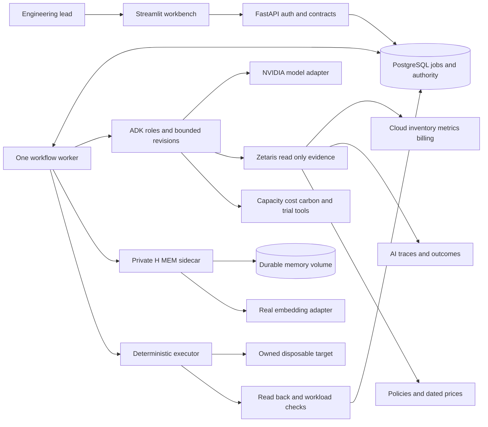

# System architecture

Status: implemented pre-event, 16 October 2026 (PREEXISTING.md). The installed versions below come from `uv.lock`. No live sponsor endpoint or measured sponsor performance is asserted.

**Locked versions (installed and smoke-tested locally; sponsor calls not yet made):** Python 3.12.11 · FastAPI 0.141.1 (0.143.x conflicts with ADK's opentelemetry pin) · Pydantic 2.14.1 · psycopg 3.3.6 · httpx 0.28.1 · Streamlit 1.66.0 · google-adk 2.12.0 · LiteLLM 1.105.1 (well past the compromised 1.82.7/1.82.8) · uvicorn 0.54.0 · pytest 9.1.1 · Hypothesis 6.170.0 · Node 22.16 (sidecar uses `--experimental-transform-types`; zero npm runtime dependencies) · PostgreSQL 16.15 locally, `postgres:17` in Compose · Meterless H-MEM reference `0aa7417b…`. Deviations: no SQLAlchemy/Alembic (ADR-19); Node 22 rather than 24. Product scope is owned by [PRODUCT_SPEC.md](PRODUCT_SPEC.md); vendor facts by [sponsor research](research/SPONSOR_RESEARCH.md).

## Decision

Build a modular Python application with a Streamlit client, FastAPI boundary and one durable job worker. Keep the Meterless reference in a private TypeScript sidecar. PostgreSQL owns workflow truth; Zetaris owns federated investigation access; H-MEM owns sourced learning. Run these on one controlled host initially. Avoid a distributed agent platform, message broker, Kubernetes or custom model training.

Arrows are permitted dependencies, not unrestricted capabilities. Agents do not get a general executor tool. The execution job enters through an authenticated API operation that validates an approved plan; the worker rechecks its invariants immediately before mutation.

## Technology and version policy

| Component | Recommended family | Reason and installation gate |
|---|---|---|
| Python | 3.12, latest patched release in that series | Conservative library target; confirm ADK/provider support in clean install |
| FastAPI and Pydantic | Current mutually compatible stable releases, Pydantic v2 | Typed input/output and generated OpenAPI; exact pins after smoke test |
| Google ADK | Supported stable Python release selected on day one | Four bounded roles; use tested loop/custom or graph workflow interface |
| Provider adapter | ADK LiteLLM connector if smoke-tested | NVIDIA tool-call and structured-output round trip required; narrow direct adapter only if needed |
| UI | Current stable Streamlit, pinned | One workbench; no durable authority in UI session state |
| Database | PostgreSQL 17, patched image pinned by digest | Transactions, uniqueness, leases and compare-and-set updates |
| DB tooling | SQLAlchemy 2 + Alembic + psycopg, pinned together | Typed repositories and reproducible migrations |
| Memory runtime | Node.js 24 LTS + TypeScript | Confirm upstream reference compatibility and build on selected Node version |
| Memory engine | Meterless reference at reviewed SHA | Vendor with Apache-2.0 notices; document narrow adapter changes |
| Packaging | uv lock for Python; npm lock for sidecar | Reproducible install and vulnerability inventory |
| Tests | pytest, Hypothesis for invariants, real browser E2E | Deterministic domain oracles plus connected evidence |
| Deployment | Docker Compose + TLS reverse proxy | One host, private internal network and durable volumes |

These are project choices, not event requirements or claims that they are newest. Freeze exact versions only after fresh installation, sponsor/model calls, and advisory review. The ADK docs now discuss graph workflows alongside older loop templates; do not blindly paste an older `LoopAgent` example. ADK's LiteLLM page lists a supply-chain advisory; exclude affected releases and inspect the current supported floor. [ADK workflows](https://adk.dev/agents/workflow-agents/loop-agents/), [ADK connector](https://adk.dev/agents/models/litellm/), [runtime support](https://nodejs.org/en/about/previous-releases), [PostgreSQL support](https://www.postgresql.org/support/versioning/).

## Module responsibilities

| Proposed path | Responsibility | Must not own |
|---|---|---|
| apps/api | Auth, request validation, job creation, read models, OpenAPI | Long-running trials inside HTTP requests |
| apps/ui | Queue, comparison, evidence and action views | Secrets for provider writes, business-rule reimplementation |
| apps/worker | Persisted jobs, leases, workflow checkpoints, reconciliation | Unbounded autonomous loops |
| agents | Coordinator, investigator, optimizer, critic; typed decisions | Arithmetic, authorization, arbitrary infrastructure commands |
| domain | Schemas, policies, accounting, freshness, applicability, plan hashing | Network calls or UI state |
| services | Investigations, trials, approvals, execution, verification, reports | Provider-specific transport details |
| adapters | Zetaris, NVIDIA, H-MEM, cloud and local sandbox clients | Hidden fallback from real to fixture mode |
| repositories | Scoped transactions, query receipts, jobs, action journal, outbox | Generated SQL from model text |
| memory-sidecar | Real H-MEM invocation, auth, persistence, embedding integration | Approval or rollback authority |
| experiments | Synthetic support workflow and independent evaluator | Access by optimizer to held-out answer keys |
| sql | Reviewed, parameterized evidence query templates | Arbitrary model-written DDL or mutations |
| data/manifests | Schema, source, seed, hashes, time coverage and provenance | Credentials or private messages |

This normalizes the supplied handoff's illustrative layout: `domain/` holds pure calculations, `apps/worker` makes durable jobs explicit, and `repositories/` owns transactions. Do not duplicate a `tools/cost.py`, `services/cost.py` and `domain/cost.py` implementation. Choose one owner and expose a thin agent-tool adapter.

## Agent contract

Coordinator scopes the question, budgets and next stage. Investigator selects approved queries, resolves conflicting evidence and retrieves applicable memory. Optimizer proposes a typed bounded candidate. Critic challenges evidence and trial failures and can return REVISE, REJECT, NEEDS_EVIDENCE or VALIDATED. The application enforces all outcomes.

Each proposal includes target identity/version, before and desired configuration, expected impact with units, required evidence IDs, assumptions and intended trial. No free-form action shell is accepted. Critic output includes check IDs and evidence references; a verdict without supporting records cannot validate a plan.

Trial tools may mutate only an isolated disposable trial fixture named in an operator-approved trial profile (target, operations, resource bounds, recovery and spend). The final action target is distinct and cannot be changed by trial tools. First release uses local pre-created worker fixtures; GCP trial fixtures require separate provisioned permissions. Model-selected trial inputs cannot expand the profile.

Loop: investigate → propose → deterministic screening → trial → critique → revise or finish. A screening rejection returns to investigation without paying for an unnecessary trial. Evidence/proposal responsiveness is budgeted separately from measured trials: target under 120 seconds, hard 180 seconds for that stage. A local paired trial has a separately persisted 15-minute cap; optional GCP trial/execution deadlines are finite configured profiles. Queued and running stages display their own clocks; no global 180-second promise covers the full loop. Each changed proposal consumes the candidate limit; retries do not create free extra candidates. Maximum three cloud and three AI candidates, explicit wall-clock/spend/call budgets, cancellation between stages. A full-budget run may end NO_CHANGE or NEEDS_REVIEW. Agent text cannot extend budgets.

## Durable workflow

The API persists job + initial event in one DB transaction and returns 202. A single worker claims a job with a DB lease, records stage entry/exit, and commits each meaningful result. Network calls run outside long database transactions. The worker periodically renews its lease; stale leases enter reconciliation. Do not use FastAPI in-process background tasks as the sole persistence mechanism.

Read jobs can safely resume from stored evidence under their freshness policy. Model calls may be repeated after an ambiguous crash, but must record uncertain billing and respect the remaining spend reservation. Mutation jobs cannot resume by blindly repeating the last call. Persist action intent and operation identifiers, then reconcile the target before deciding the next step.

P0 has one durable global execution slot shared by mutating trials, actions and recovery, plus a per-target active-action uniqueness constraint. Unknown outcomes retain the slot until reconciled; a lease timeout alone cannot free it for another mutation. Read investigations may continue within budgets. One action per target is enforced by an active-action uniqueness constraint/lock, not only worker count. Use an action journal for stop, resize, start, health and recovery stages. Single-worker deployment reduces concurrency but does not remove HTTP retry or crash races. Never advertise exactly-once external effects when the provider offers no equivalent guarantee.

## State ownership

| Entity | Lifecycle |
|---|---|
| Investigation | QUEUED → RUNNING → AWAITING_APPROVAL, COMPLETED, NO_CHANGE, NEEDS_REVIEW, FAILED or CANCELLED |
| Candidate plan | DRAFT → NEEDS_EVIDENCE or REJECTED or VALIDATED → AWAITING_APPROVAL → APPROVED; any invalidating change → STALE. An INCOMPLETE trial leaves the plan DRAFT (not judged; re-trial allowed) |
| Trial | QUEUED → RUNNING → PASSED, FAILED, INCOMPLETE or CANCELLED |
| Approval | ACTIVE → CONSUMED, EXPIRED, REVOKED or STALE |
| Action | QUEUED → EXECUTING → PENDING_VERIFICATION → VERIFIED, FAILED or RECOVERY_REQUIRED → RECOVERING → RECOVERED or RECOVERY_REQUIRED; RECOVERY_REQUIRED → RESOLVED_MANUALLY only through the authenticated operator procedure (`make resolve-action`) |

These are separate typed enums. A trial FAILED does not imply an action FAILED; an action VERIFIED does not mean financial saving has been measured on a bill. Preserve historical validations and append invalidation events instead of overwriting the record that explains the original decision.

## Memory integration and consistency

Use H-MEM for recalled rejected trials, verified outcomes and reviewed corrections. The inspected reference is file-backed, includes a mock hash embedder, lacks HTTP authentication, and does not enforce our tenant/service boundaries. Add a minimal private wrapper and a real embedding adapter; preserve the engine's actual retrieval and audit functions. The source lacks a drop-in async embedder constructor, so the narrow upstream extension must be attributed and tested. See [sponsor research](research/SPONSOR_RESEARCH.md).

Canonical experiment receipts stay in PostgreSQL. Commit a memory-outbox item with each receipt. A serial dispatcher writes an idempotent application envelope to H-MEM and records engine ID + acknowledgment. A duplicate outbox delivery must not create conflicting experiments. After restart, reconcile pending outbox items by application receipt ID. Do not regenerate an action or approval from a memory entry.

Filter by exact tenant, service and applicable workload/policy/model/test/config versions before ranking in the narrow retrieval extension, and validate returned candidates again before context injection. Reject unscoped memories; do not rely solely on post-filtering a small top-k that may already have excluded the correct scoped result. Retain obsolete memories as history with an inapplicable reason. Store embeddings with model ID/dimension/preprocessing version; rebuild the index explicitly on changes. Corrections must maintain both relationship directions required by the reference engine; simple insertion is insufficient proof of supersession.

If an action succeeded but memory publication failed, action status remains its factual verified status and `memory_sync_status=PENDING/FAILED` is shown. Block new memory-dependent investigations or writes until the declared policy can be met, but allow read-only reports. Never falsify execution history because a secondary service is unavailable.

## Deployment and trust boundaries

UI and API are the only ingress surfaces. DB, worker and sidecar are private. One tenant, one sidecar writer and durable host volumes are the supported P0 topology. Put approved sample source databases where Zetaris can reach them with TLS and scoped credentials; a hosted service cannot reach a laptop's localhost. Keep app-action tables outside model-readable source views.

Cloud Run is not the default for the file-backed sidecar. Splitting stateless components across hosts adds networking, authentication and operations work that is unnecessary for this sprint. The GCP executor is enabled only for a team-owned disposable target after explicit configuration and permission. Local sandbox mode must execute a real local change and identify it as an analogue.

Reports are deterministic, redacted, private downloads backed by persisted receipt IDs. No Google Drive publishing, report-agent swarm, recurring optimization or multi-tenant hosting is required. Follow [OPERATIONS.md](OPERATIONS.md) for recovery and [API_REFERENCE.md](API_REFERENCE.md) for exact proposed application boundaries.
